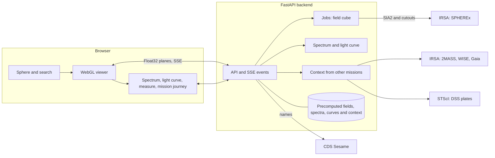

# SkyBlink

[Versión en español](README.md)

SkyBlink is a web tool for looking at the infrared sky of the SPHEREx mission over time. It shows the images of a patch of sky from each pass of the survey, so you can find objects that move or change in brightness, and it extracts their spectrum between 0.75 and 5 µm. It was built for the SPHEREx challenge of NASA Space Apps 2026.

**Public version:** https://spherex-explorer-p5tb.onrender.com

## What you can do

- **Find a place** by name or coordinates, spin the celestial sphere, pick any point of the sky with a click, turn on the constellations to get your bearings, or land on a "random place" among 21 precomputed fields. On a phone, the sphere works as a window to the sky: it shows what lies where you point it.
- **Compare epochs.** Each field has 3 or 4 SPHEREx passes in six bands. You can blink them, subtract them (difference), add them, overlay them in red and cyan, or switch between two by holding a button.
- **See the spectrum** of a source with one click: flux against wavelength, with error bars, H₂O, CH₄, CO₂ and CO bands, a "chemical fingerprint" labelled as a hint, and the option to listen to it.
- **See the light curve** of that source, per band, in the next tab.
- **Measure proper motion** by marking the object in each epoch.
- **Travel between missions:** Digitized Sky Survey photographic plates (from 1950), 2MASS, WISE and SPHEREx, in date order; a curtain to compare visible against infrared; Gaia stars with their motion arrows; and a plain-language card about the object.
- **Follow a six-step guided tour** to find WISE 0855, a brown dwarf 7 light-years away.
- **Open any other field.** If it is not precomputed, it is built on the spot from IRSA data (about 3 minutes) and the images appear as they arrive.

The whole state lives in the URL, so any view can be shared as a link.

## Running it locally

You need Python 3.12 with [uv](https://docs.astral.sh/uv/), and Node 20.18 or newer with pnpm 12. The commands are for PowerShell.

```powershell
# Backend (http://127.0.0.1:8000)
cd backend
uv sync
uv run uvicorn app.api.main:app --port 8000 --timeout-graceful-shutdown 5

# Frontend, in another terminal (http://localhost:5173)
cd frontend
pnpm install
pnpm dev
```

The 22 precomputed fields (`backend/data/fields`) open without a connection to IRSA. Opening any other place downloads about 300 to 500 cutouts from IRSA.

Configuration: the backend is tuned with `SPHEREX_*` environment variables; the full table is in [backend/README.md](backend/README.md). Two of them decide where the data of a new field come from, and the public deployment sets them in [render.yaml](render.yaml): `SPHEREX_CUTOUT_SOURCE=auto` builds the cutout from the public AWS bucket (`nasa-irsa-spherex`) when IRSA's cutout service answers busy or drops the connection, and `SPHEREX_DISCOVER_RELEASES=1` takes the list of collections from the folders of that bucket. To go back to the previous behaviour, set `SPHEREX_CUTOUT_SOURCE=irsa` and `SPHEREX_DISCOVER_RELEASES=0`.

The public version is a single Docker image with the API, the built frontend and the precomputed fields:

```powershell
docker build -t skyblink .
docker run --rm -p 7860:7860 skyblink
```

Tests and style:

```powershell
cd backend;  uv run pytest -q; uv run ruff check .
cd frontend; pnpm lint; pnpm typecheck; pnpm test
```

The tests do not use the network: they run on real cutouts and responses saved in the repository.

### Precomputing a field with its spectrum, light curve and context

From `backend/`, in this order. Steps 1, 4 and 5 use the network; steps 2 and 3 do not. Steps 2 to 5 go through every field in `data/fields`; for a single one, the scripts of steps 2 and 3 take `--only <field id>` and those of steps 4 and 5 take the object's name.

```powershell
# 1. The field: lists the exposures, downloads the cutouts from IRSA and builds the cube in data/fields
uv run python scripts/precompute.py "Wolf 359"
#    If it ends "partial" because IRSA did not deliver some cutout:
uv run python scripts/precompute.py "Wolf 359" --refresh

# 2. Spectra of its object and of its brightest sources (no network, from the cutouts in cache/cutouts)
uv run python scripts/precompute_field_spectra.py --workers 4

# 3. Light curves of those same sources (no network)
uv run python scripts/precompute_field_lightcurves.py --workers 4

# 4. Context: 2MASS, WISE and Gaia from IRSA
uv run python scripts/precompute_context_fields.py

# 5. Digitized Sky Survey plates from STScI
uv run python scripts/precompute_optical.py
```

For the new field to open even when the name service does not answer, copy its answer from `backend/cache/sesame/` to `backend/data/sesame/`. For it to come up in "random place" and open in its best band, add a line to `frontend/src/features/entry/featured.ts`. Details are in [backend/README.md](backend/README.md) (in Spanish).

## Architecture

The backend (Python, FastAPI, astropy) uses SIA2 to list the SPHEREx exposures that cover a point, downloads a cutout of each from IRSA, subtracts the zodiacal light, masks them and brings them onto a common grid. From those it builds the "field cube": one image per epoch and per detector, plus their flag and coverage layers. The frontend (React, TypeScript, WebGL) receives those planes as Float32 arrays and does everything else in the browser: stretch, contrast, comparisons between epochs and annotations. The spectrum and the light curve do not come from the cube but from aperture photometry on each individual exposure, because each exposure sees the object at a different wavelength. A new field is built by a background job that publishes its progress as server-sent events, and nothing that queries external services runs in the browser.



Documents (in Spanish):

- [SPEC.md](SPEC.md): data, architecture, API, stages and risks. It is the source of truth for the scope.
- [docs/contrato-cubo.md](docs/contrato-cubo.md): the contract between backend and frontend for the field cube.
- [spike/RESULTADOS.md](spike/RESULTADOS.md): the initial technical spike against IRSA, with the first measurements.
- [docs/contexto.md](docs/contexto.md) and [docs/contexto-2.md](docs/contexto-2.md): 2MASS, WISE, Gaia and DSS plates.
- [docs/alas-saturadas.md](docs/alas-saturadas.md): what happens when you measure on the wings of a saturated star.
- [DESIGN.md](DESIGN.md): the design system.
- [backend/README.md](backend/README.md) and [frontend/README.md](frontend/README.md): how each part is put together.

## Measured results

All of them come from real SPHEREx data downloaded from IRSA on 15 November 2026. Each number says where it comes from.

| What | Measured | Reference | Source |
|---|---|---|---|
| Proper motion of Barnard's Star, with the Measure tool (three epochs, band 3) | 10.31 ± 0.44 ″/yr | 10.45 ″/yr: what the catalogue gives with the positions expected on those same dates, at 0.8 sigma. The catalogue proper motion is 10.39 ″/yr | Browser check on the precomputed field |
| Proper motion of WISE 0855, with the Measure tool (three epochs, band 6) | 8.00 ± 1.47 ″/yr: 7.88 west and 1.35 north | 8.15 ″/yr from the catalogue, at 0.5 sigma | Browser check on the precomputed field, with one click on the object in each epoch; the click snaps to the centroid |
| Shift of Barnard's Star between the first and the last epoch (12 months) | 10.3″ north and 0.6″ west | 10.25″ and 0.77″ expected from proper motion and parallax | [spike/RESULTADOS.md](spike/RESULTADOS.md), section 5 |
| Shift of WISE 0855 between epochs 1 and 3, in bands 5 and 6 | 7.5″ and 7.7″ west, 1.3″ north | 8.0″ west and 0.65″ north expected; 8.15 ″/yr from the catalogue | [spike/RESULTADOS.md](spike/RESULTADOS.md), section 6 |
| Detection of WISE 0855 | Signal-to-noise of 10 per epoch in band 6 (0.5 mJy) and 8 to 11 in band 5 | Not detected in bands 1 to 4 | [spike/RESULTADOS.md](spike/RESULTADOS.md), section 6 |
| Variation of R Draconis between passes, bands 4 to 6, measured on the wings | Relative amplitude of 0.61 to 0.66, at 9.6, 10.7 and 11.4 sigma; brightest in epoch 1 and faintest in epoch 3 | Barnard's Star, a control star measured with the same method: 0.005 to 0.035, below 1 sigma | `backend/data/lightcurves/rdra.json` and `barnard.json` |
| Variation of RW Aurigae | Relative amplitude of 0.34 in band 1 (aperture, 6.4 sigma), 0.56 in band 5 and 0.66 in band 6 (wings, 12 sigma) | Epsilon Indi B, the control for aperture photometry: 0.03 at most, below 1 sigma | `backend/data/lightcurves/rwaur.json` and `epsindb.json` |
| Spectrum of WISE 0855 | 224 points over three epochs. Median per band: 0.74, 0.63, 0.49 and 0.23 mJy from band 1 to 4, and 0.42 and 0.53 mJy in bands 5 and 6 | The light in bands 1 to 4 is centred 5.7″ away from the object: it is a background star inside the aperture. The object's own light is the rise between 4 and 5 µm | `backend/data/spectra/wise0855.json` |
| How much a good epoch comparison helps (WISE 0855, band 6, red/cyan) | From 2.5 to 7.6 sigma when comparing the two best-covered epochs with a linear stretch | | Header of `frontend/src/features/guide/tour.ts` |
| Time to build a field | 138 to 157 s for 258 to 458 exposures, with 10 parallel downloads | | [docs/contrato-cubo.md](docs/contrato-cubo.md), section 11 |


## Known limits

- **Saturation.** Bright stars saturate the detector. Barnard's Star, Proxima Centauri, Kapteyn's Star and R Draconis saturate in all six bands: they have no spectrum. RW Aurigae leaves 18 valid measurements, all in band 1. M 42 has 47 saturated sources and a blank centre.
- **The light curve of a saturated source is relative.** It is measured on the wings of the star and says how much it changed, not how bright it is.
- **Bands 2 and 3 have no curve for saturated sources.** There the wings method did not pass validation: the control star does not come out flat, and the cause was not found.
- **Three epochs.** A field has 3 or 4 passes about six months apart. That is enough to see that something moved or changed, not to measure a period. With only two marks from opposite seasons, proper motion cannot be separated from parallax.
- **Neighbouring sources.** The aperture has a radius of 9.2″ and a SPHEREx pixel is 6.15″. A source a few arcseconds away falls inside the measurement: for WISE 0855, the spectrum below 3.8 µm belongs to a background star. The neighbour warning of the Measure tool does not see neighbours closer than about 5″.
- **Dependence on IRSA.** A new field depends on IRSA answering. On 15 November 2026 the exposure listing was down for more than an hour and the cutout service answered "503 Server busy" to a good share of the requests; one field ended without 178 of its 458 cutouts. In that case the field is left "incomplete" and can be completed later.
- **10-arcminute fields only** in the public version. The 30′ field exists in the code but was never tested with real data.
- **Partial context.** There is no SIMBAD lookup and no solar-system objects. DSS plates are photographic densities, not fluxes: they are for looking, not for measuring. Two fields have a single plate with a reliable date.
- **Sky window.** It was tested on a single Android phone.
- **Not verified:**
  - The molecular bands on the chart come from the literature and were not checked against SPHEREx spectra.
  - It was not tested in Firefox, Safari or screen readers; only in desktop Chrome and Edge and in phone emulation. On a real phone, only the sky window was tested.
  - "Complete the field" was tested through the API and with a simulated backend, not in a browser against IRSA.
  - Most of the interface was reviewed by hand and with short checks in a headless browser, not with an end-to-end test suite.

## Data and credits

- **SPHEREx.** Level 2 images from the IRSA archive (DR1 and QR3 collections; QR3 DOI: [10.26131/IRSA662](https://www.ipac.caltech.edu/doi/10.26131/IRSA662)).
  > This publication makes use of data products from the Spectro-Photometer for the History of the Universe, Epoch of Reionization and Ices Explorer (SPHEREx), which is a joint project of the Jet Propulsion Laboratory and the California Institute of Technology, and is funded by the National Aeronautics and Space Administration.
- **IRSA.** 2MASS, WISE and Gaia also come from there.
  > This research has made use of the NASA/IPAC Infrared Science Archive, which is funded by the National Aeronautics and Space Administration and operated by the California Institute of Technology.
- **2MASS.**
  > This publication makes use of data products from the Two Micron All Sky Survey, which is a joint project of the University of Massachusetts and the Infrared Processing and Analysis Center/California Institute of Technology, funded by the National Aeronautics and Space Administration and the National Science Foundation.
- **WISE (AllWISE).**
  > This publication makes use of data products from the Wide-field Infrared Survey Explorer, which is a joint project of the University of California, Los Angeles, and the Jet Propulsion Laboratory/California Institute of Technology, and NEOWISE, which is a project of the Jet Propulsion Laboratory/California Institute of Technology. WISE and NEOWISE are funded by the National Aeronautics and Space Administration.
- **Gaia DR3.** ESA/Gaia/DPAC. Gaia data are distributed under the CC BY-NC 3.0 IGO license, which does not allow commercial use ([license](https://www.cosmos.esa.int/web/gaia-users/license), [credits](https://www.cosmos.esa.int/web/gaia-users/credits)).
- **Digitized Sky Survey (DSS).** Plates downloaded from the STScI archive (MAST). They are not in the public domain. According to the [MAST data use page](https://archive.stsci.edu/publishing/data-use), they may be used freely for scientific, educational and non-profit purposes, under the CC BY-NC-SA 4.0 license, which forbids commercial use. The copyright holder depends on the plate, and the application shows it under each one:
  > Southern Hemisphere Surveys observed prior to 1993: The digitized images are copyright (c) 1976-1993, jointly by the UK SERC/PPARC (formerly Science and Engineering Research Council/Particle Physics and Astronomy Research Council, and currently the Science and Technology Facilities Council), and are distributed herein by agreement. All Rights Reserved.
  >
  > Southern Hemisphere Surveys observed since 1993: The digitized images are copyright (c) 1993-2004 by the Anglo-Australian Observatory Board, and are distributed herein by agreement.
  >
  > POSS-II Northern Hemisphere Surveys: The compressed files of the "Palomar Observatory - Space Telescope Science Institute Digital Sky Survey" of the northern sky, based on scans of the Second Palomar Sky Survey are copyright (c) 1993-2003 by the California Institute of Technology and are distributed herein by agreement.
  >
  > POSS-I/Quick-V Northern Hemisphere Surveys: All material not subject to one of the above copyright provisions is copyright (c) 1984-2004 by the Association of Universities for Research in Astronomy, Inc.
- **Star map on the sphere.** "Deep Star Maps 2020", NASA Scientific Visualization Studio. Credit: NASA/Goddard Space Flight Center Scientific Visualization Studio. Gaia DR2: ESA/Gaia/DPAC. It is visible light, not a SPHEREx image. Details in [frontend/src/features/sphere/assets/FUENTES.md](frontend/src/features/sphere/assets/FUENTES.md).
- **Constellations and star names on the sphere.** The figures, the constellation names and the names and positions of the 200 bright stars come from [d3-celestial](https://github.com/ofrohn/d3-celestial), by Olaf Frohn (BSD 3-Clause license, "Copyright (c) 2015, Olaf Frohn"), which takes the stars from the XHIP catalogue (Anderson and Francis, 2012). The boundaries come from the table by Nancy Roman (1987, PASP 99, 695; CDS catalogue VI/42), taken from the astropy package (BSD 3-Clause). The text of both licenses and the details are in [frontend/src/features/sphere/assets/](frontend/src/features/sphere/assets/FUENTES.md).
- **Object names.** Sesame and SIMBAD, from CDS.
  > This research has made use of the SIMBAD database, operated at CDS, Strasbourg, France. 2000, A&AS, 143, 9, "The SIMBAD astronomical database", Wenger et al.
- **Code contributions.** Reading cutouts from the public AWS bucket when IRSA answers busy, and discovering the collections from that bucket, are by agusmelo (Agustin Melo), in pull request #1.

The quoted texts were copied from each project's pages on 15 November 2026: [SPHEREx](https://irsa.ipac.caltech.edu/data/SPHEREx/docs/overview_qr.html), [IRSA](https://irsa.ipac.caltech.edu/ack.html), [2MASS](https://irsa.ipac.caltech.edu/Missions/2mass.html), [AllWISE](https://irsa.ipac.caltech.edu/data/WISE/docs/release/AllWISE/expsup/sec1_6b.html), [DSS](https://archive.stsci.edu/publishing/data-use) and [SIMBAD](https://simbad.cfa.harvard.edu/simbad/).

## Use of AI in development

SkyBlink's code was written with AI assistance (Claude, by Anthropic), under the team's direction and review. Specifically, the code, tests and documentation in this repository were written with Claude Code, Anthropic's coding agent. The work was done in stages, starting from a specification ([SPEC.md](SPEC.md)) and with the team's approval between one stage and the next. Several sessions worked in parallel, each on its own branch (spectrum, light curves, sphere, context, measuring tool, guided tour), and were merged at the end.

- Decisions about scope, design and what to measure were made by the team.
- The names of tables, columns and parameters of external services were looked up in their documentation or checked against the real service, and every assumption that turned out false was corrected in the specification.
- The numbers in this README come from real runs against IRSA data, and each one cites its source.
- What could not be verified is listed under "Known limits".
- This README was also drafted with AI, from those same documents and data.

## License

The code is released under the MIT license ([LICENSE](LICENSE)). Third-party data shipped with the repository keep their own terms: in particular, the Digitized Sky Survey plates (`backend/data/context/*/dss*.f32`, CC BY-NC-SA 4.0) and the Gaia sources (`backend/data/context/*/gaia.json`, CC BY-NC 3.0 IGO) do not allow commercial use.

SkyBlink is an independent project made for NASA Space Apps 2026. It is not a NASA product and does not imply NASA's endorsement.
