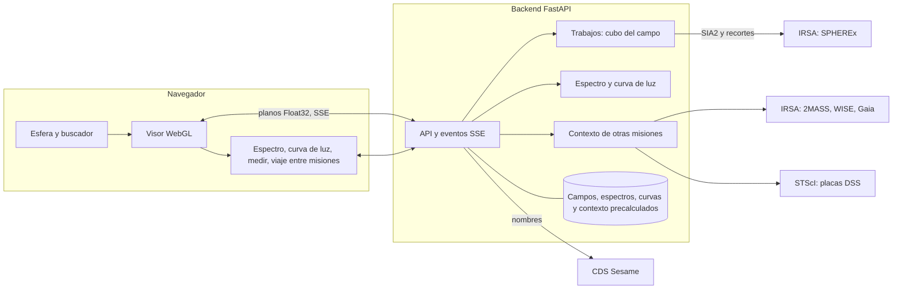

# SkyBlink

[English version](README.en.md)

SkyBlink es una herramienta web para mirar el cielo infrarrojo de la misión SPHEREx a lo largo del tiempo. Muestra las imágenes de una zona del cielo en cada pasada del relevamiento, para encontrar objetos que se mueven o que cambian de brillo, y extrae su espectro entre 0,75 y 5 µm. Se hizo para el desafío SPHEREx de NASA Space Apps 2026.

**Versión pública:** https://spherex-explorer-p5tb.onrender.com

## Qué se puede hacer

- **Buscar un lugar** por nombre o por coordenadas, girar la esfera celeste, elegir cualquier punto del cielo con un clic, prender las constelaciones para ubicarse o caer en un "lugar al azar" entre 13 campos ya calculados. En el teléfono, la esfera funciona como una ventana al cielo: muestra lo que hay hacia donde se apunta.
- **Comparar épocas.** Cada campo tiene 3 o 4 pasadas de SPHEREx en seis bandas. Se pueden parpadear, restar (diferencia), sumar, superponer en rojo y cian o alternar manteniendo apretado.
- **Ver el espectro** de una fuente con un clic: flujo contra longitud de onda, con barras de error, bandas de H₂O, CH₄, CO₂ y CO, una "huella química" rotulada como indicio y la opción de escucharlo.
- **Ver la curva de luz** de esa fuente, por banda, en la pestaña de al lado.
- **Medir el movimiento propio** marcando el objeto en cada época.
- **Viajar entre misiones:** placas fotográficas del Digitized Sky Survey (desde 1950), 2MASS, WISE y SPHEREx, en orden de fecha; una cortina para comparar visible contra infrarrojo; las estrellas de Gaia con su flecha de movimiento, y una ficha del objeto en lenguaje llano.
- **Seguir un recorrido guiado** de seis pasos para encontrar a WISE 0855, una enana marrón a 7 años luz.
- **Abrir cualquier otro campo.** Si no está calculado, se arma en el momento con datos de IRSA (unos 3 minutos) y las imágenes aparecen a medida que llegan.

Todo el estado va en la URL, así que cualquier vista se comparte con un link.

## Cómo correrlo en local

Hace falta Python 3.12 con [uv](https://docs.astral.sh/uv/), y Node 20.18 o más nuevo con pnpm 12. Los comandos son de PowerShell.

```powershell
# Backend (http://127.0.0.1:8000)
cd backend
uv sync
uv run uvicorn app.api.main:app --port 8000 --timeout-graceful-shutdown 5

# Frontend, en otra terminal (http://localhost:5173)
cd frontend
pnpm install
pnpm dev
```

Los 14 campos precalculados (`backend/data/fields`) abren sin conexión a IRSA. Abrir cualquier otro lugar descarga unos 300 a 500 recortes de IRSA.

La versión pública es una sola imagen de Docker con la API, el frontend compilado y los campos precalculados:

```powershell
docker build -t skyblink .
docker run --rm -p 7860:7860 skyblink
```

Pruebas y estilo:

```powershell
cd backend;  uv run pytest -q; uv run ruff check .
cd frontend; pnpm lint; pnpm typecheck; pnpm test
```

Los tests no usan la red: corren sobre recortes y respuestas reales guardados en el repositorio.

### Precalcular un campo con su espectro, su curva y su contexto

Desde `backend/`, en este orden. Los pasos 1, 4 y 5 usan la red; el 2 y el 3, no. Los pasos 2 a 5 recorren todos los campos de `data/fields`; para uno solo, los scripts de los pasos 2 y 3 aceptan `--only <id del campo>` y los de los pasos 4 y 5, el nombre del objeto.

```powershell
# 1. El campo: lista las exposiciones, baja los recortes de IRSA y arma el cubo en data/fields
uv run python scripts/precompute.py "Wolf 359"
#    Si queda "partial" porque IRSA no entregó algún recorte:
uv run python scripts/precompute.py "Wolf 359" --refresh

# 2. Espectros de su objeto y de sus fuentes más brillantes (sin red, con los recortes en cache/cutouts)
uv run python scripts/precompute_field_spectra.py --workers 4

# 3. Curvas de luz de esas mismas fuentes (sin red)
uv run python scripts/precompute_field_lightcurves.py --workers 4

# 4. Contexto: 2MASS, WISE y Gaia desde IRSA
uv run python scripts/precompute_context_fields.py

# 5. Placas del Digitized Sky Survey desde STScI
uv run python scripts/precompute_optical.py
```

Para que el campo nuevo abra aunque el servicio de nombres no responda, hay que copiar su respuesta de `backend/cache/sesame/` a `backend/data/sesame/`. Para que salga en "Lugar al azar" y abra en su mejor banda, se agrega un renglón en `frontend/src/features/entry/featured.ts`. El detalle está en [backend/README.md](backend/README.md).

## Arquitectura

El backend (Python, FastAPI, astropy) lista con SIA2 las exposiciones de SPHEREx que cubren un punto, baja de IRSA un recorte de cada una, les resta la luz zodiacal, las enmascara y las lleva a una grilla común. Con eso arma el "cubo del campo": una imagen por época y por detector, más sus capas de flags y cobertura. El frontend (React, TypeScript, WebGL) recibe esos planos como arreglos Float32 y hace todo lo demás en el navegador: estirado, contraste, comparaciones entre épocas y anotaciones. El espectro y la curva de luz no salen del cubo sino de fotometría de apertura sobre cada exposición individual, porque cada exposición ve el objeto a otra longitud de onda. Un campo nuevo se arma en un trabajo en segundo plano que publica su avance por eventos (SSE), y nada de lo que consulta servicios externos corre en el navegador.



Documentos:

- [SPEC.md](SPEC.md): datos, arquitectura, API, etapas y riesgos. Es la fuente de verdad del alcance.
- [docs/contrato-cubo.md](docs/contrato-cubo.md): contrato entre backend y frontend para el cubo del campo.
- [spike/RESULTADOS.md](spike/RESULTADOS.md): prueba técnica inicial contra IRSA, con las primeras mediciones.
- [docs/contexto.md](docs/contexto.md) y [docs/contexto-2.md](docs/contexto-2.md): 2MASS, WISE, Gaia y placas del DSS.
- [docs/alas-saturadas.md](docs/alas-saturadas.md): qué pasa al medir sobre las alas de una estrella saturada.
- [DESIGN.md](DESIGN.md): sistema de diseño.
- [backend/README.md](backend/README.md) y [frontend/README.md](frontend/README.md): cómo está armada cada parte.

## Resultados medidos

Todos salen de datos reales de SPHEREx bajados de IRSA el 15 de noviembre de 2026. Cada número dice de dónde sale.

| Qué | Medido | Referencia | Fuente |
|---|---|---|---|
| Movimiento propio de Barnard's Star, con la herramienta Medir (tres épocas, banda 3) | 10,31 ± 0,44 ″/año | 10,45 ″/año: lo que da el catálogo con las posiciones esperadas en esas mismas fechas, a 0,8 sigmas. El movimiento propio de catálogo es 10,39 ″/año | Comprobación en navegador sobre el campo precalculado |
| Movimiento propio de WISE 0855, con la herramienta Medir (tres épocas, banda 6) | 8,00 ± 1,47 ″/año: 7,88 al oeste y 1,35 al norte | 8,15 ″/año de catálogo, a 0,5 sigmas | Comprobación en navegador sobre el campo precalculado, con un clic sobre el objeto en cada época; el clic se ajusta al centroide |
| Desplazamiento de Barnard entre la primera y la última época (12 meses) | 10,3″ al norte y 0,6″ al oeste | 10,25″ y 0,77″ esperados por movimiento propio y paralaje | [spike/RESULTADOS.md](spike/RESULTADOS.md), sección 5 |
| Desplazamiento de WISE 0855 entre la época 1 y la 3, en las bandas 5 y 6 | 7,5″ y 7,7″ al oeste, 1,3″ al norte | 8,0″ al oeste y 0,65″ al norte esperados; 8,15 ″/año de catálogo | [spike/RESULTADOS.md](spike/RESULTADOS.md), sección 6 |
| Detección de WISE 0855 | Señal sobre ruido de 10 por época en la banda 6 (0,5 mJy) y de 8 a 11 en la 5 | En las bandas 1 a 4 no se detecta | [spike/RESULTADOS.md](spike/RESULTADOS.md), sección 6 |
| Variación de R Draconis entre pasadas, bandas 4 a 6, medida en las alas | Amplitud relativa de 0,61 a 0,66, a 9,6, 10,7 y 11,4 sigmas; más brillante en la época 1 y más débil en la 3 | Barnard's Star, estrella de control medida con el mismo método: 0,005 a 0,035, a menos de 1 sigma | `backend/data/lightcurves/rdra.json` y `barnard.json` |
| Variación de RW Aurigae | Amplitud relativa de 0,34 en la banda 1 (apertura, 6,4 sigmas), 0,56 en la 5 y 0,66 en la 6 (alas, 12 sigmas) | Epsilon Indi B, control de la apertura: 0,03 como máximo, a menos de 1 sigma | `backend/data/lightcurves/rwaur.json` y `epsindb.json` |
| Espectro de WISE 0855 | 224 puntos en tres épocas. Mediana por banda: 0,74, 0,63, 0,49 y 0,23 mJy de la banda 1 a la 4, y 0,42 y 0,53 mJy en la 5 y la 6 | La luz de las bandas 1 a 4 está corrida 5,7″ del objeto: es una estrella de fondo dentro de la apertura. La del objeto es la subida entre 4 y 5 µm | `backend/data/spectra/wise0855.json` |
| Cuánto ayuda comparar bien las épocas (WISE 0855, banda 6, rojo/cian) | De 2,5 a 7,6 sigmas al comparar las dos épocas mejor cubiertas con estirado lineal | | Cabecera de `frontend/src/features/guide/tour.ts` |
| Tiempo para armar un campo | 138 a 157 s para 258 a 458 exposiciones, con 10 descargas en paralelo | | [docs/contrato-cubo.md](docs/contrato-cubo.md), sección 11 |


## Límites conocidos

- **Saturación.** Las estrellas brillantes saturan el detector. Barnard's Star, Proxima Centauri, la estrella de Kapteyn y R Draconis saturan en las seis bandas: no tienen espectro. RW Aurigae deja 18 medidas válidas, todas en la banda 1. M 42 tiene 47 fuentes saturadas y el centro en blanco.
- **La curva de luz de una fuente saturada es relativa.** Se mide en las alas de la estrella y dice cuánto cambió, no cuánto brilla.
- **Bandas 2 y 3 sin curva en fuentes saturadas.** Ahí el método de las alas no pasó la validación: la estrella de control no sale plana, y no se encontró la causa.
- **Tres épocas.** Un campo tiene 3 o 4 pasadas separadas por unos seis meses. Alcanza para ver que algo se movió o cambió, no para medir un período. Con solo dos marcas de estaciones opuestas, el movimiento propio no se puede separar de la paralaje.
- **Fuentes vecinas.** La apertura mide 9,2″ de radio y un pixel de SPHEREx, 6,15″. Una fuente a pocos segundos de arco entra en la medida: en WISE 0855, el espectro por debajo de 3,8 µm es de una estrella de fondo. El aviso de fuente vecina de la herramienta Medir no ve vecinas a menos de unos 5″.
- **Dependencia de IRSA.** Un campo nuevo depende de que IRSA responda. El 15 de noviembre de 2026 el listado de exposiciones estuvo caído más de una hora y el servicio de recortes respondió "503 Server busy" a buena parte de los pedidos; un campo terminó sin 178 de sus 458 recortes. En ese caso el campo queda "incompleto" y se puede completar después.
- **Solo campos de 10 minutos de arco** en la versión pública. El campo de 30′ existe en el código pero nunca se probó con datos reales.
- **Contexto parcial.** No hay SIMBAD ni objetos del sistema solar. Las placas del DSS son densidades fotográficas, no flujos: sirven para mirar, no para medir. Dos campos tienen una sola placa con fecha fiable.
- **Sin verificar:**
  - Las bandas moleculares del gráfico salen de la bibliografía y no se contrastaron con espectros de SPHEREx.
  - No se probó en Firefox, en Safari, en teléfonos reales ni con lectores de pantalla; solo en Chrome y Edge de escritorio y en emulación de celular.
  - "Completar el campo" se probó por la API y con un backend simulado, no en un navegador contra IRSA.
  - La mayor parte de la interfaz se revisó a mano y con comprobaciones cortas en un navegador sin ventana, no con una batería de pruebas de extremo a extremo.

## Datos y créditos

- **SPHEREx.** Imágenes de nivel 2 del archivo de IRSA (colecciones DR1 y QR3; DOI de QR3: [10.26131/IRSA662](https://www.ipac.caltech.edu/doi/10.26131/IRSA662)).
  > This publication makes use of data products from the Spectro-Photometer for the History of the Universe, Epoch of Reionization and Ices Explorer (SPHEREx), which is a joint project of the Jet Propulsion Laboratory and the California Institute of Technology, and is funded by the National Aeronautics and Space Administration.
- **IRSA.** De ahí salen también 2MASS, WISE y Gaia.
  > This research has made use of the NASA/IPAC Infrared Science Archive, which is funded by the National Aeronautics and Space Administration and operated by the California Institute of Technology.
- **2MASS.**
  > This publication makes use of data products from the Two Micron All Sky Survey, which is a joint project of the University of Massachusetts and the Infrared Processing and Analysis Center/California Institute of Technology, funded by the National Aeronautics and Space Administration and the National Science Foundation.
- **WISE (AllWISE).**
  > This publication makes use of data products from the Wide-field Infrared Survey Explorer, which is a joint project of the University of California, Los Angeles, and the Jet Propulsion Laboratory/California Institute of Technology, and NEOWISE, which is a project of the Jet Propulsion Laboratory/California Institute of Technology. WISE and NEOWISE are funded by the National Aeronautics and Space Administration.
- **Gaia DR3.** ESA/Gaia/DPAC. Los datos de Gaia se distribuyen bajo la licencia CC BY-NC 3.0 IGO, que no permite el uso comercial ([licencia](https://www.cosmos.esa.int/web/gaia-users/license), [créditos](https://www.cosmos.esa.int/web/gaia-users/credits)).
- **Digitized Sky Survey (DSS).** Placas bajadas del archivo de STScI (MAST). No son de dominio público. Según la [página de uso de datos de MAST](https://archive.stsci.edu/publishing/data-use), se pueden usar libremente con fines científicos, educativos y sin fines de lucro, bajo la licencia CC BY-NC-SA 4.0, que prohíbe el uso comercial. El titular depende de la placa, y la aplicación lo muestra debajo de cada una:
  > Southern Hemisphere Surveys observed prior to 1993: The digitized images are copyright (c) 1976-1993, jointly by the UK SERC/PPARC (formerly Science and Engineering Research Council/Particle Physics and Astronomy Research Council, and currently the Science and Technology Facilities Council), and are distributed herein by agreement. All Rights Reserved.
  >
  > Southern Hemisphere Surveys observed since 1993: The digitized images are copyright (c) 1993-2004 by the Anglo-Australian Observatory Board, and are distributed herein by agreement.
  >
  > POSS-II Northern Hemisphere Surveys: The compressed files of the "Palomar Observatory - Space Telescope Science Institute Digital Sky Survey" of the northern sky, based on scans of the Second Palomar Sky Survey are copyright (c) 1993-2003 by the California Institute of Technology and are distributed herein by agreement.
  >
  > POSS-I/Quick-V Northern Hemisphere Surveys: All material not subject to one of the above copyright provisions is copyright (c) 1984-2004 by the Association of Universities for Research in Astronomy, Inc.
- **Mapa estelar de la esfera.** "Deep Star Maps 2020", NASA Scientific Visualization Studio. Crédito: NASA/Goddard Space Flight Center Scientific Visualization Studio. Gaia DR2: ESA/Gaia/DPAC. Es luz visible, no una imagen de SPHEREx. Detalle en [frontend/src/features/sphere/assets/FUENTES.md](frontend/src/features/sphere/assets/FUENTES.md).
- **Constelaciones y nombres de estrellas de la esfera.** Las figuras, los nombres de las constelaciones y los nombres y posiciones de las 200 estrellas brillantes salen de [d3-celestial](https://github.com/ofrohn/d3-celestial), de Olaf Frohn (licencia BSD de 3 cláusulas, "Copyright (c) 2015, Olaf Frohn"), que toma las estrellas del catálogo XHIP (Anderson y Francis, 2012). Los límites, de la tabla de Nancy Roman (1987, PASP 99, 695; catálogo VI/42 del CDS), tomada del paquete astropy (BSD de 3 cláusulas). Los textos de las dos licencias y el detalle van en [frontend/src/features/sphere/assets/](frontend/src/features/sphere/assets/FUENTES.md).
- **Nombres de objetos.** Sesame y SIMBAD, del CDS.
  > This research has made use of the SIMBAD database, operated at CDS, Strasbourg, France. 2000, A&AS, 143, 9, "The SIMBAD astronomical database", Wenger et al.

Los textos entre comillas se copiaron de las páginas de cada proyecto el 15 de noviembre de 2026: [SPHEREx](https://irsa.ipac.caltech.edu/data/SPHEREx/docs/overview_qr.html), [IRSA](https://irsa.ipac.caltech.edu/ack.html), [2MASS](https://irsa.ipac.caltech.edu/Missions/2mass.html), [AllWISE](https://irsa.ipac.caltech.edu/data/WISE/docs/release/AllWISE/expsup/sec1_6b.html), [DSS](https://archive.stsci.edu/publishing/data-use) y [SIMBAD](https://simbad.cfa.harvard.edu/simbad/).

## Uso de IA en el desarrollo

El código de SkyBlink fue escrito con asistencia de IA (Claude, de Anthropic), bajo la dirección y la revisión del equipo. En concreto, el código, los tests y la documentación de este repositorio se escribieron con Claude Code, el agente de programación de Anthropic. El trabajo se hizo por etapas, a partir de una especificación ([SPEC.md](SPEC.md)) y con aprobación del equipo entre una etapa y la siguiente. Varias sesiones trabajaron en paralelo, cada una en su rama (espectro, curvas de luz, esfera, contexto, medidor, recorrido guiado), y se fusionaron al final.

- Las decisiones de alcance, de diseño y de qué medir las tomó el equipo.
- Los nombres de tablas, columnas y parámetros de los servicios externos se consultaron en su documentación o contra el servicio real, y cada supuesto falso se corrigió en la especificación.
- Los números de este README salen de corridas reales contra los datos de IRSA, y cada uno cita su fuente.
- Lo que no se llegó a verificar figura en "Límites conocidos".
- Este README también se redactó con IA, a partir de esos mismos documentos y datos.

## Licencia

El código se publica bajo la licencia MIT ([LICENSE](LICENSE)). Los datos de terceros que acompañan al repositorio conservan sus propias condiciones: en particular, las placas del Digitized Sky Survey (`backend/data/context/*/dss*.f32`, CC BY-NC-SA 4.0) y las fuentes de Gaia (`backend/data/context/*/gaia.json`, CC BY-NC 3.0 IGO) no admiten uso comercial.

SkyBlink es un proyecto independiente hecho para NASA Space Apps 2026. No es un producto de NASA ni implica su aval.
