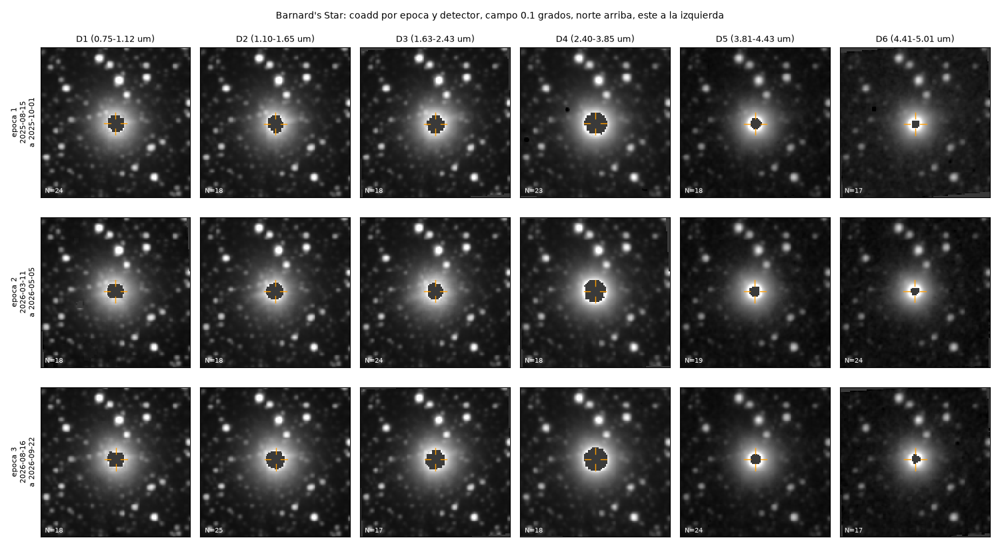
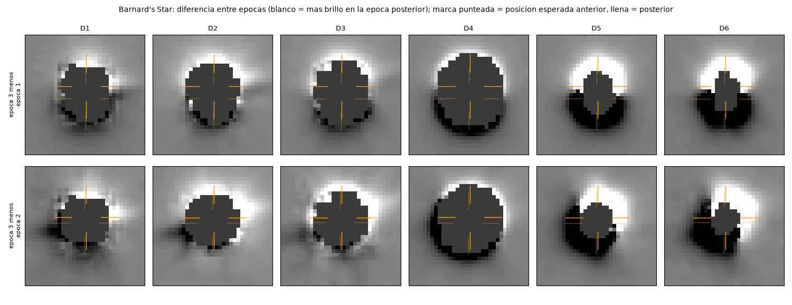
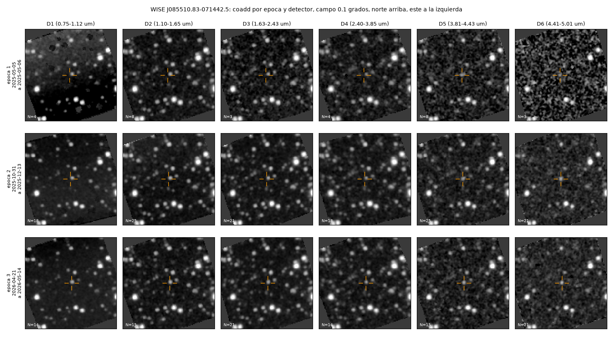
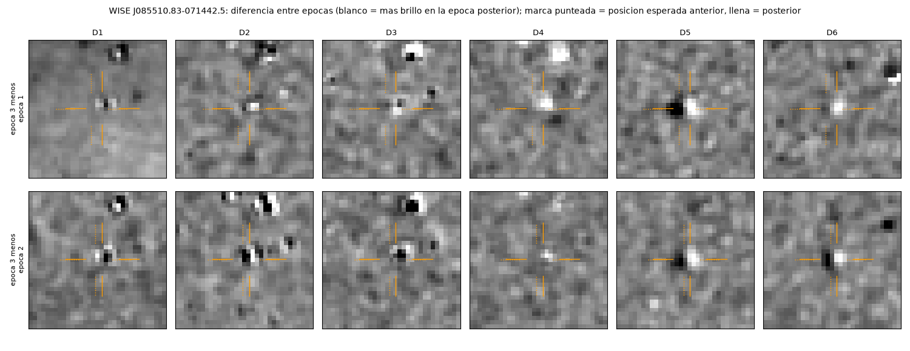
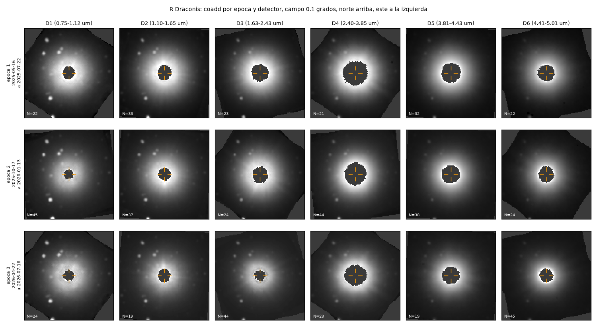
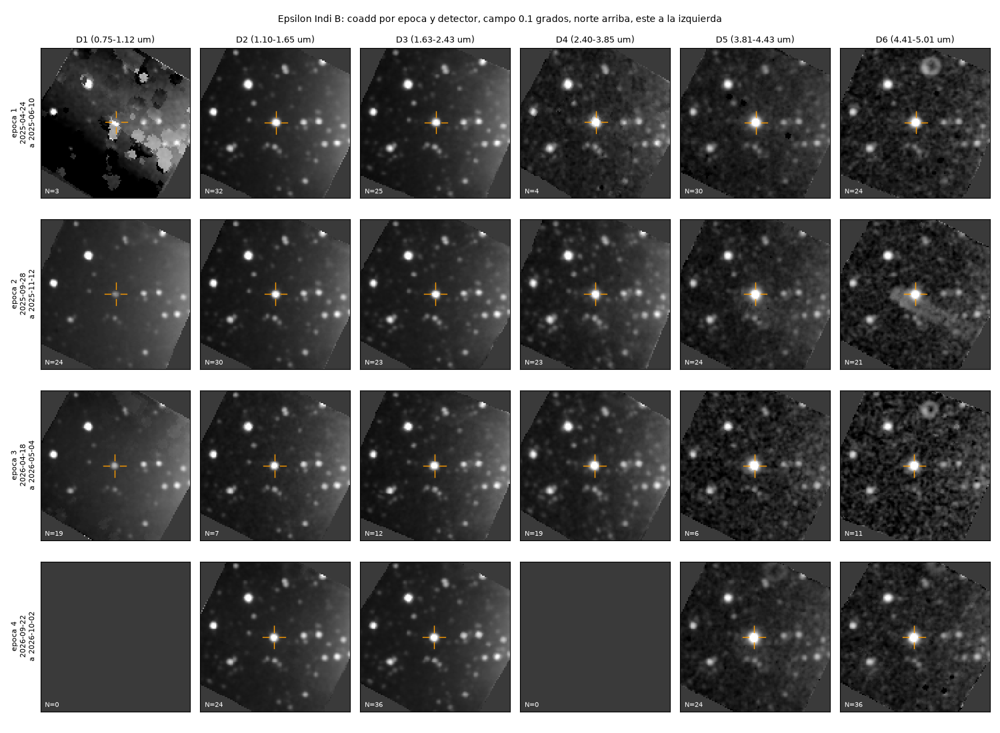
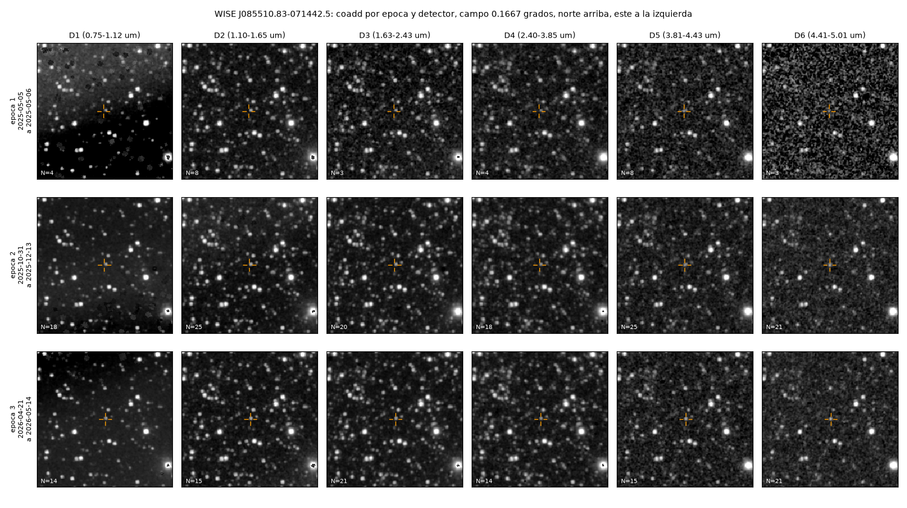

# Etapa 0 — Resultados de la prueba técnica

Corrida del 15 de noviembre de 2026, entre las 05:00 y las 06:25 UTC, desde Windows 11 con Python 3.12.8. Todas las cifras salen de esa única sesión: sirven como orden de magnitud, no como promedio.

## Respuestas cortas

| Pregunta | Respuesta |
|---|---|
| ¿Cuántas épocas reales hay? | 3 en los dos objetos. Barnard: ago–oct 2025, mar–may 2026, ago–sep 2026. WISE 0855: may 2025, oct–dic 2025, abr–may 2026. |
| ¿Barnard se ve desplazarse? | Sí. Entre la primera y la última época (12 meses) el centro medido se corre 10,3" hacia el norte y 0,6" hacia el oeste, es decir 1,68 px nativos. Lo esperado por movimiento propio y paralaje es 10,25" y 0,77". |
| ¿WISE 0855 es detectable? | Sí, en D6 (4,4–5,0 µm) con S/R ≈ 10 por época cuando hay 21 exposiciones, y en D5 (3,8–4,4 µm) con S/R entre 8 y 11. En D1 a D4 no aparece. La fuente de D5 y D6 se mueve 7,6" al oeste en un año, como predice su movimiento propio. |
| ¿Cuánto tarda un campo nuevo? | Entre 105 y 185 s para 258 a 358 exposiciones: 4 a 57 s de consulta, 85 a 125 s de descarga y 10 a 16 s de proceso. Con los recortes en caché, 12 a 17 s. |
| ¿Cuántos recortes fallan? | Entre el 17 % y el 46 % recibe al menos un 503 "Server busy". Con 4 intentos quedó fallido del 0 % al 7 %; con 6 intentos y respetando `Retry-After`, del 0 % al 1 %. |
| ¿Qué supuesto de `SPEC.md` falló? | El principal: TAP no sirvió para listar exposiciones (agota el tiempo de espera). Se usó SIA2. Detalle en la sección 7. |

## 1. Cómo reproducir

```powershell
cd spike
uv sync
uv run python verify.py                      # escala de píxel y formato de la URL de recorte
uv run python field.py --name "Barnard's Star" --fov 0.1 --label barnard
uv run python field.py --name "WISE J085510.83-071442.5" --fov 0.1 --label wise0855
uv run python summarize.py barnard wise0855  # tablas de este documento
uv run python check_tap.py                   # estado de TAP
```

`field.py` escribe en `spike/out/<label>/` (ignorado por git): un PNG por época y detector, `mosaico.png`, `acercamiento.png`, `diferencia.png`, `cubo.fits` y `resumen.json`. Los archivos citados acá están copiados en `spike/resultados/`.

Archivos de código:

| Archivo | Qué hace |
|---|---|
| `irsa.py` | Consultas SIA2 y TAP, descarga de recortes en paralelo, reintentos, caché en disco |
| `field.py` | El pipeline completo: resolver nombre, listar, bajar, restar ZODI, enmascarar, reproyectar, coadd, PNG y JSON |
| `verify.py` | Comprueba los dos puntos marcados **[VERIFICAR]** |
| `check_tap.py` | Repite la consulta TAP del tutorial oficial y dice si responde |
| `summarize.py` | Arma las tablas a partir de `resumen.json` |
| `explore_*.py` | Pruebas puntuales: esquema TAP, transferencia de un recorte, tabla WCS-WAVE, cobertura de la grilla |

## 2. Verificación de lo marcado [VERIFICAR]

### Escala de píxel

| Fuente | Valor |
|---|---|
| `s_pixel_scale` (ObsCore, leída por SIA2; 992 filas de tres campos, DR1 y QR3) | 6,15 "/px en todas |
| `s_xel1` × `s_xel2`, `s_fov` | 2040 × 2040 px, 3,485° |
| WCS de un archivo real (M101, D2, proyección `TAN-SIP`) | 6,130 × 6,148 "/px; lado 3,474° × 3,484° |

Confirmado: 6,15 "/px y 3,5° de campo. La columna existe en `spherex.obscore` según `TAP_SCHEMA` (`resultados/tap_schema.txt`), pero no se pudo leer por TAP (sección 8).

### Formato de la URL de recorte

```
<access_url>?center=<ra>,<dec>d&size=<lado>
```

Probado contra el servicio con un archivo de M101 (`resultados/verify.txt`):

| Parámetro | Resultado |
|---|---|
| `size=0.1` | 59 × 59 px (0,1005° × 0,1008°). Sin unidad, son grados. |
| `size=0.1deg`, `6arcmin`, `360arcsec`, `59px` | Mismo recorte de 59 × 59 px |
| `size=0.1,0.05` | 59 × 29 px: ancho, alto |
| `center=ra,dec`, `ra,decd`, `ra,decdeg` | Válidos y equivalentes |
| `center=210.8d,54.3d` | HTTP 422: la unidad va una sola vez, al final |
| Centro fuera de la imagen | HTTP 422 `Arrays do not overlap.` No tiene sentido reintentarlo. |

Otros hechos del recorte:

- Se ajusta a píxeles enteros: el punto pedido queda hasta 0,5 px del centro geométrico.
- Viene en la orientación del detector, no con el norte arriba.
- Trae las siete extensiones: PRIMARY, IMAGE, FLAGS, VARIANCE, ZODI, EPSF y WCS-WAVE. En el recorte FLAGS es una imagen `int32` sin comprimir; en el archivo completo está comprimida.
- Pesa 4,0 MB con 0,1° de lado, de los cuales 3,9 MB son la tabla EPSF, que viene entera (441 filas) sin importar el tamaño del recorte.
- El servidor no comprime la respuesta e ignora la cabecera `Range` en recortes (en el archivo completo sí la respeta).
- El primer byte llega a 1,1 s; el resto es transferencia a unos 0,5 MB/s por conexión (`resultados/cutout_transfer.txt`). El archivo completo de 65 MB tardó entre 100 y 140 s.

## 3. Tiempos medidos

Dos corridas en frío por objeto. La primera usó 4 intentos por recorte; la segunda, 6 intentos respetando `Retry-After`. Siempre 10 conexiones y campo de 0,1°.

| | Barnard 1.ª | Barnard 2.ª | WISE 0855 1.ª | WISE 0855 2.ª |
|---|---|---|---|---|
| Exposiciones | 358 | 358 | 258 | 258 |
| Consulta SIA2 (dos colecciones) | 6,0 s | 11,6 s | 56,7 s | 3,9 s |
| Descarga | 85,4 s (346 recortes) | 124,0 s | 112,8 s | 86,6 s |
| Recortes con al menos un reintento | 59 (17 %) | 65 (18 %) | 105 (41 %) | 45 (17 %) |
| Recortes fallidos | 0 | 0 | 11 (4,3 %) | 0 |
| Tiempo por recorte: mediana / p90 / máximo | 1,7 / 4,8 / 11 s | 1,8 / 7,7 / 32 s | 1,8 / 8,7 / 18 s | 1,8 / 7,5 / 33 s |
| Bytes recibidos | 43 MB | 45 MB | 31 MB | 32 MB |
| Resta, máscara, reproyección y coadd | 14,6 s | 15,7 s | 10,1 s | 11,4 s |
| Total | 104 s | 155 s | 185 s | 106 s |

Con los recortes ya en caché, la corrida completa tarda de 12 a 17 s; casi todo es reproyección y figuras.

La consulta de 56,7 s incluye reintentos: SIA2 devuelve HTTP 502 de forma intermitente. Una corrida falló directamente porque SIA2 respondió 502 seis veces seguidas (57 s) antes de la primera fila. Cuando responde, tarda de 1 a 5 s por colección.

### Recorte completo contra recorte cortado

Las extensiones de imagen vienen antes que EPSF, así que `irsa.py` lee el FITS de a un HDU y cierra la conexión al llegar a EPSF.

| Modo | Bytes por recorte | Mediana por recorte | Ritmo con 10 conexiones |
|---|---|---|---|
| Completo | 4,0 MB | 12,5 s | 0,6 recortes/s (38 en 59 s, más 2 fallidos) |
| Cortado antes de EPSF | 125 kB | 1,7 s | 2,9 a 4,1 recortes/s (358 en 124 s; 346 en 85 s) |

El modo cortado no trae WCS-WAVE, que va después de EPSF. No hace falta: la tabla resultó idéntica en los 38 recortes completos de un mismo detector (tres épocas, DR1 y QR3). Lo que cambia entre recortes es `CRPIX1W` y `CRPIX2W`, que están en el encabezado de IMAGE (`resultados/wcswave.txt`). Para la Etapa 2 alcanza con bajar un recorte completo por detector.

### Conexiones en paralelo

100 recortes nuevos por prueba, 4 intentos:

| Conexiones | Tiempo | Con reintento | Fallidos |
|---|---|---|---|
| 3 | 90,8 s | 30 | 0 |
| 5 | 80,9 s | 44 | 5 |
| 10 | 44,0 s | 32 | 7 |
| 10, con `Retry-After` y 6 intentos | 120,5 s | 46 | 1 |

Todos los fallos fueron HTTP 503 con cuerpo `Server busy, retry later.` y cabecera `Retry-After: 5`. Aparecen también con 3 conexiones, así que dependen de la carga del servidor más que de la nuestra. La última fila se midió minutos después, con el servidor más cargado; no es comparable con las otras tres.

## 4. Exposiciones y épocas

No hubo exposiciones duplicadas entre DR1 y QR3. En estos campos DR1 llega hasta mayo de 2026 y QR3 empieza en agosto de 2026.

### Barnard's Star: 358 exposiciones

| Época | Fechas | Exposiciones | D1 | D2 | D3 | D4 | D5 | D6 | Colección | Días con datos |
|---|---|---|---|---|---|---|---|---|---|---|
| 1 | 2025-08-15 a 2025-10-01 | 118 | 24 | 18 | 18 | 23 | 18 | 17 | DR1 | 15 |
| 2 | 2026-03-11 a 2026-05-05 | 121 | 18 | 18 | 24 | 18 | 19 | 24 | DR1 | 11 |
| 3 | 2026-08-16 a 2026-09-22 | 119 | 18 | 25 | 17 | 18 | 24 | 17 | QR3 | 13 |

### WISE 0855: 258 exposiciones

| Época | Fechas | Exposiciones | D1 | D2 | D3 | D4 | D5 | D6 | Colección | Días con datos |
|---|---|---|---|---|---|---|---|---|---|---|
| 1 | 2025-05-05 a 2025-05-06 | 30 | 4 | 8 | 3 | 4 | 8 | 3 | DR1 | 2 |
| 2 | 2025-10-31 a 2025-12-13 | 128 | 18 | 25 | 21 | 18 | 25 | 21 | DR1 | 9 |
| 3 | 2026-04-21 a 2026-05-14 | 100 | 14 | 15 | 21 | 14 | 15 | 21 | DR1 | 16 |

QR3 no tiene todavía ninguna exposición sobre WISE 0855 (consulta repetida, 0 filas). La cuarta pasada caería en noviembre de 2026.

Dos cosas a tener en cuenta:

- Una "época" no es una fecha: cada pasada dura de 2 a 7 semanas, con exposiciones sueltas hasta seis semanas después del grupo principal. La regla de 60 días las junta bien.
- La primera época de WISE 0855 es pobre (30 exposiciones en dos días, al inicio del relevamiento). Con 3 o 4 exposiciones por detector quedan gradientes y huecos en el coadd.

## 5. Barnard's Star



Barnard satura. El núcleo queda enmascarado en las 18 combinaciones de época y detector: un hueco de unos 15" a 30" de diámetro justo sobre la estrella. Por eso el centroide ponderado por flujo no sirve, y el centro se midió ajustando un perfil de Moffat de ancho fijo a las alas no enmascaradas, dentro de 6 px nativos.

Posición: Sesame da la posición J2000 de SIMBAD con movimiento propio (−801,6 y +10362,4 mas/año), paralaje (547,0 mas) y velocidad radial. `field.py` la propaga a la fecha media de cada grupo de exposiciones y suma el desplazamiento paraláctico. En 26 años la estrella se movió 4,5', más que el medio campo de 3': sin propagar, queda fuera de la imagen.

Desplazamiento entre la época 1 y la 3:

| Detector | Días | Medido E | Medido N | Esperado E | Esperado N |
|---|---|---|---|---|---|
| D1 | 354 | −0,13" | +11,01" | −0,75" | +10,13" |
| D2 | 361 | −0,18" | +9,31" | −0,78" | +10,29" |
| D3 | 362 | +0,59" | +11,36" | −0,78" | +10,32" |
| D4 | 354 | −2,64" | +9,23" | −0,74" | +10,12" |
| D5 | 361 | −0,90" | +9,98" | −0,78" | +10,30" |
| D6 | 362 | −0,55" | +11,01" | −0,78" | +10,32" |
| **Media** | | **−0,64" ± 0,45"** | **+10,32" ± 0,38"** | −0,77" | +10,25" |

El error es el de la media entre los seis detectores (dispersión de 1,1" y 0,9"). El módulo medido es 10,34", o 1,68 px nativos. En cada época y detector, el centro ajustado queda a menos de 2,2" de la posición esperada.



La resta de épocas muestra el desplazamiento mejor que el parpadeo: un dipolo norte-sur en los seis detectores.

## 6. WISE 0855



Las coordenadas de `SPEC.md` (08h55m10,831s, −07°14'42,53") son la posición de 2010. El objeto se mueve 8,1" por año hacia el oeste: en 2026 está 126" más allá, en RA 133,7598°, Dec −7,2422°. El campo se centró ahí.

Medición sobre el coadd, en la posición esperada de cada época. Apertura de 9,2" de radio (1,5 px nativos), sin corrección de apertura. El ruido es la dispersión de aperturas iguales repartidas por el campo.

| Época | Detector | Exposiciones | S/R | Flujo en la apertura | Centro medido respecto del esperado |
|---|---|---|---|---|---|
| 1 | D4 | 4 | 1,1 | 0,05 mJy | 11,2" (es la estrella vecina) |
| 1 | D5 | 8 | 7,7 | 0,34 mJy | 1,8" |
| 1 | D6 | 3 | 2,5 | 0,26 mJy | 0,8" |
| 2 | D4 | 18 | 3,6 | 0,16 mJy | 8,0" (estrella vecina) |
| 2 | D5 | 25 | 7,6 | 0,34 mJy | 3,2" |
| 2 | D6 | 21 | 10,0 | 0,49 mJy | 1,2" |
| 3 | D4 | 14 | 6,0 | 0,28 mJy | 4,0" (estrella vecina) |
| 3 | D5 | 15 | 10,6 | 0,42 mJy | 1,8" |
| 3 | D6 | 21 | 10,1 | 0,50 mJy | 1,0" |

Por qué es WISE 0855 y no otra cosa:

- En D1 a D4 hay una estrella de fondo fija en RA 133,7582°, Dec −7,2412°. Su centro medido no cambia entre épocas (menos de 0,5").
- En D5 y D6 hay una fuente en la posición esperada, que entre la época 1 y la 3 se corre 7,5" y 7,7" al oeste y 1,3" al norte. Lo esperado es 8,0" al oeste y 0,65" al norte.
- El flujo en D6, 0,5 mJy, es del orden del que tiene el objeto en la banda W2 de WISE (cifra citada de memoria, no consultada en esta sesión).



Reservas:

- WISE 0855 se está acercando a esa estrella: 11,4" en mayo de 2025, 8,1" en noviembre de 2025 y 4,2" en mayo de 2026. A la resolución de SPHEREx ya están mezcladas. En D6 el flujo no cambia entre las épocas 2 y 3, así que la estrella aporta poco; en D5 sube de 0,34 a 0,42 mJy y en D4 de 0,16 a 0,28 mJy, o sea que ahí sí contamina.
- En la época 1, D6 tiene solo 3 exposiciones: S/R 2,5 no alcanza como detección por sí sola.
- No se hizo fotometría con PSF ni se separaron las dos fuentes.

Conclusión para el criterio de la etapa: WISE 0855 es detectable en D6 con coadd por época. No hace falta el plan B de marcar la posición esperada sin fuente visible, aunque la marca sigue siendo útil porque el objeto es débil y tiene una vecina.

## 7. Supuestos de SPEC.md que resultaron falsos o incompletos

1. **TAP como vía para listar exposiciones.** No funcionó en toda la sesión. La consulta del tutorial oficial (20 s según el tutorial) agotó 240 s sobre Barnard y 311 s sobre M101, la posición del propio tutorial (`resultados/check_tap.txt`). El modo asíncrono crea el trabajo pero lo deja en `QUEUED`, más de 5 minutos en la primera prueba, incluso para `SELECT TOP 1` sobre `TAP_SCHEMA`. Las consultas triviales en modo síncrono responden, con HTTP 502 inmediatos en una de cada cuatro (3 de 12 en una muestra). SIA2 dio la misma información en segundos.
2. **Rendimiento de referencia (84 imágenes: 20 s de consulta y 13 s de descarga).** No se reproduce. El recorte completo tardó 12,5 s de mediana, contra 1,6 s por imagen en la corrida en serie del tutorial. Con 10 conexiones salieron 38 recortes completos en 59 s.
3. **La extensión se llama EPSF, no PSF**, y viene entera en cada recorte: es el 96 % de los bytes con 0,1° de campo.
4. **Coordenadas de WISE 0855.** Son las de 2010. La URL de ejemplo de la sección 3.3 (`ra=133.795&dec=-7.245&fov=0.1`) deja al objeto a 20 px del centro. Hay que propagar por movimiento propio igual que con Barnard.
5. **"Recorte centrado, norte arriba".** El recorte viene en la orientación del detector. Con un recorte del mismo lado que el campo, las esquinas de la grilla quedan sin datos: 88 % a 91 % de cobertura en WISE 0855 y 97 % a 100 % en Barnard (`resultados/cobertura.txt`). Hay que pedir el recorte más grande que el campo.
6. **"Restar ZODI" no deja el fondo en cero.** Queda un residuo positivo, de 0,06 a 0,23 MJy/sr en el campo de Barnard y de 0,01 a 0,03 en el de WISE 0855, que además varía entre exposiciones. `field.py` resta la mediana de cada recorte después de ZODI.
7. **Lista de bits de FLAGS.** La real tiene 22 bits. Faltaban en `SPEC.md`: SUR_ERROR, DICHROIC, MISSING_DATA, FULLSAMPLE, PHANMISS, NONLINEAR, CROSSTALK, GHOST_FPA y GHOST_EXT.
8. **Las estrellas brillantes saturan.** Barnard queda con un hueco en el centro en todos los detectores. Afecta al visor y a la idea de marcar el objeto a mano en la Etapa 5.
9. **Desplazamiento de "unos 2 px".** Medido: 1,68 px para Barnard y 1,25 px para WISE 0855, en 12 meses. El orden de magnitud era correcto.
10. **Menos de 3 s para objetos en caché.** Con los recortes en caché, rehacer el cubo tarda de 10 a 16 s. Hay que guardar el cubo ya armado, no solo los recortes.

Se confirmaron sin cambios: seis detectores con esos rangos de longitud de onda, 2040 × 2040 px, unidades MJy/sr, nombres de tablas y columnas de TAP (`resultados/tap_schema.txt`), claves `MSKNnnnn` y `MSKDnnnn`, colecciones `spherex_dr1` y `spherex_qr3`, y cientos de exposiciones por punto.

## 8. Lo que no se pudo verificar

- **La consulta TAP de punta a punta.** `field.py --source tap` está escrito con las columnas de `TAP_SCHEMA` pero nunca devolvió filas. `spherex.plane.position_samplesize` tampoco se pudo leer.
- **Si la falla de TAP es habitual o de esa noche.** `check_tap.py` lo responde en cinco minutos.
- **WCS-WAVE fija por detector** se comprobó en un solo campo y una sola versión de procesamiento (`l2b-v27`).
- **Flujo absoluto.** Sin corrección de apertura ni comparación contra un catálogo.
- **Las colecciones `_deep`** no se consultaron. Los otros tres objetos de prueba se corrieron después; están en la sección 11.
- **Acceso por AWS S3.** SIA2 devuelve una columna `cloud_access` con el bucket `nasa-irsa-spherex`. No se probó; podría evitar el servicio de recortes.
- **CDS.** Sesame, SIMBAD y VizieR en Estrasburgo no respondieron durante unos minutos (404 y timeout). El espejo de Sesame en CfA respondió; `field.py` prueba los dos.

## 9. Decisiones tomadas en el pipeline

- **Grilla de salida:** proyección TAN, norte arriba, 3,075 "/px (el doble de muestreo que el detector), 117 × 117 px para 0,1°.
- **Centro de la grilla:** la posición del objeto en la época 2026,0, fija. Si dependiera de las fechas de las exposiciones, cada exposición nueva invalidaría la caché de recortes.
- **Máscara:** los 19 flags del aviso `CONTAINS_BAD_PIXEL` del suplemento explicativo, como en el tutorial oficial de fotometría (los que figuren en el encabezado de cada archivo). SOURCE no se enmascara. Queda enmascarado el 4,7 % de los píxeles en Barnard y el 2,7 % en WISE 0855.
- **Reproyección:** bilineal (`reproject_interp`), imagen y varianza juntas.
- **Coadd:** media ponderada por inversa de la varianza, por época y detector.

Límite del coadd por detector: cada exposición ve el objeto a otra longitud de onda, y cada época muestrea longitudes de onda distintas. Una fuente fija con color no se anula del todo al restar épocas; se ve en la estrella vecina de WISE 0855.

## 10. Recomendaciones para la Etapa 1

1. Listar exposiciones por SIA2, con TAP como alternativa, y guardar la última lista buena para cuando IRSA no responda.
2. Cortar la descarga antes de EPSF y bajar WCS-WAVE una vez por detector.
3. Respetar `Retry-After` en los 503 y dejar una segunda pasada para los recortes que falten.
4. Pedir el recorte con lado `fov × √2` para llenar la grilla con cualquier ángulo de giro.
5. Guardar el cubo armado por (ra, dec, fov), no solo los recortes.
6. Propagar la posición con movimiento propio y paralaje para cualquier objeto que los tenga en Sesame.
7. Decidir cómo mostrar los núcleos saturados: hueco, valor de relleno o capa aparte.

## 11. Fase A de la Etapa 1: los otros tres objetos

Corridas del 15 de noviembre de 2026 entre las 06:53 y las 07:10 UTC, con el mismo `field.py`, campo de 0,1°, 10 conexiones y 6 intentos por recorte.

```powershell
uv run python field.py --name "Epsilon Indi B" --fov 0.1 --label epsindb
uv run python field.py --name "RW Aurigae" --fov 0.1 --label rwaur
uv run python field.py --name "R Draconis" --fov 0.1 --label rdra
```

| | Epsilon Indi B | RW Aurigae | R Draconis |
|---|---|---|---|
| Exposiciones (DR1 + QR3) | 458 (338 + 120) | 335 (226 + 109) | 539 (413 + 126) |
| Épocas | 4 | 3 | 3 |
| Consulta SIA2 | 6,3 s | 31,2 s | 5,8 s |
| Descarga | 209,2 s | 123,6 s | 198,6 s |
| Recortes con al menos un reintento | 133 (29 %) | 74 (22 %) | 119 (22 %) |
| Recortes fallidos | 1 | 0 | 0 |
| Mediana por recorte | 1,7 s | 1,8 s | 1,8 s |
| Resta, máscara, reproyección y coadd | 19,2 s | 13,9 s | 22,9 s |
| Total | 235 s | 169 s | 227 s |
| Cobertura de la grilla | 84 % a 88 % | 96 % a 99 % | 80 % a 97 % |
| Saturación del objeto | No | Parcial, de D2 a D6 | Total, en los 18 planos |

### R Draconis

Tiene 539 exposiciones, no miles: una vez y media las de Barnard. Está a unos 9° del polo eclíptico y lo que cambia es la duración de cada pasada, no tanto la cantidad.

| Época | Fechas | Duración | Exposiciones | D1 | D2 | D3 | D4 | D5 | D6 |
|---|---|---|---|---|---|---|---|---|---|
| 1 | 2025-05-16 a 2025-07-22 | 67 días | 153 | 22 | 33 | 23 | 21 | 32 | 22 |
| 2 | 2025-10-17 a 2026-01-13 | 88 días | 212 | 45 | 37 | 24 | 44 | 38 | 24 |
| 3 | 2026-04-22 a 2026-07-16 | 85 días | 174 | 24 | 19 | 44 | 23 | 19 | 45 |

- El mayor hueco entre exposiciones consecutivas es de 99 días, así que la regla de 60 días sigue separando 3 épocas. Pero cada una abarca casi tres meses, y R Draconis es una variable de período largo: el coadd de una época promedia un cambio de brillo real.
- Tarda 227 s en total, 199 de descarga.
- **Satura por completo.** El núcleo no tiene ningún píxel válido en ninguna época ni detector, y el hueco mide de unos 40" (D1) a 90" (D4) de diámetro. El halo llena el campo: el fondo residual después de restar ZODI es de 0,3 a 0,6 MJy/sr, contra 0,01 a 0,03 en WISE 0855.



Esto pone en duda el criterio de la Etapa 2, "clic en R Draconis muestra espectro y curva de luz coherentes": no hay píxeles válidos sobre la estrella en ninguna exposición. Queda por ver si la fotometría sobre las alas alcanza, o si conviene otra variable más débil.

### Epsilon Indi B

- Cuatro épocas: abr–jun 2025, sep–nov 2025, abr–may 2026 y sep–oct 2026. La primera empieza el 24 de abril de 2025, antes de la fecha que `SPEC.md` daba como inicio del relevamiento.
- Se ve nítido en los seis detectores, sin saturar, con S/R de cientos.
- Entre la época 1 y la 4 (505 días) se mueve 4,87" ± 0,09" al este y 3,79" ± 0,09" al sur: 6,2", un píxel nativo. Lo esperado es 5,12" y 3,71".
- **Hay planos vacíos y planos pobres.** En la época 4, D1 y D4 no tienen ninguna exposición. En la época 1, D1 tiene 3 y D4 tiene 4, y el coadd de D1 queda inservible, con parches y gradientes.
- Se ven artefactos que los flags no cubren: anillos en D6 y un rastro alargado junto al objeto en la época 2 de D5 y D6. Epsilon Indi A, muy brillante, está a 7′.



### RW Aurigae

- Tres épocas de 2 a 3 semanas, con 18 o 19 exposiciones por detector, muy parejas.
- Satura a medias. D1 queda entero; de D2 a D6 queda válido entre el 0 % y el 78 % del núcleo, según la época y el detector.
- En D1, el único detector sin saturación, la suma de apertura sube de 97 a 118 y a 164 mJy entre épocas. Es compatible con la variabilidad conocida de la estrella, pero cada época muestrea otras longitudes de onda, así que no alcanza como medida.
- Donde hay saturación parcial la suma de apertura no sirve: en D6 da 160, 1014 y 429 mJy.
- No se mueve: 0,45" medidos contra 0,02" esperados, dentro de la dispersión entre detectores (1").

### Pruebas para el contrato del cubo

**Qué flags forman el hueco de una estrella saturada** (358 recortes de Barnard, `resultados/saturacion_barnard.txt`):

| Zona | Píxeles descartados | BLOOM | OVERFLOW | SUR_ERROR | TRANSIENT |
|---|---|---|---|---|---|
| Núcleo, radio hasta 1,5 px | 99,3 % | 97,6 % | 59,5 % | 69,2 % | 45,2 % |
| Anillo, de 1,5 a 3 px | 78,5 % | 77,8 % | 1,6 % | 67,9 % | 76,9 % |
| Halo, de 3 a 6 px | 19,6 % | 17,0 % | 0,1 % | 8,0 % | 17,4 % |

En el núcleo, una cuarta parte de los píxeles descartados trae `NaN` en IMAGE; el resto trae valores con mediana 10 veces mayor que el máximo válido del recorte.

**Cuánto cuesta un recorte según el campo**, con lado `fov × √2 + 4 px` y cortando antes de EPSF (`resultados/cutout_sizes.txt`, una conexión):

| Campo | Recorte | Bytes | Tiempo |
|---|---|---|---|
| 5′ | 73 px | 0,16 MB | 1,8 s |
| 10′ | 142 px | 0,40 MB | 2,3 s |
| 20′ | 281 px | 1,34 MB | 4,2 s |
| 30′ | 419 px | 2,88 MB | 8,8 s |
| 1° | 835 px | 11,2 MB | 31,2 s |

Un campo de 1° con 358 exposiciones son 4 GB.

**Campo de 10′ con recortes agrandados** (WISE 0855, 258 exposiciones, `--fov 0.1667 --cutout-scale 1.4142`):

- Cobertura del 100 % en los 18 planos, contra 88 % a 91 % con el recorte del mismo lado que el campo.
- 257 recortes en 206,8 s y 1 fallido; 114 con reintento (44 %); mediana 2,9 s por recorte; 102 MB. El proceso tarda 14,4 s para planos de 195 × 195 px.
- La detección de WISE 0855 no cambia: S/R 10,3 y 10,7 en D6.



**Compresión del cubo** (`resultados/cubo_tamano.txt`): 18 planos de 117 × 117 px pesan 0,99 MB en Float32. gzip los deja en 0,83 a 0,90 MB, entre un 8 % y un 16 % menos. La capa de cobertura comprime de 0,49 a 0,05 MB.
